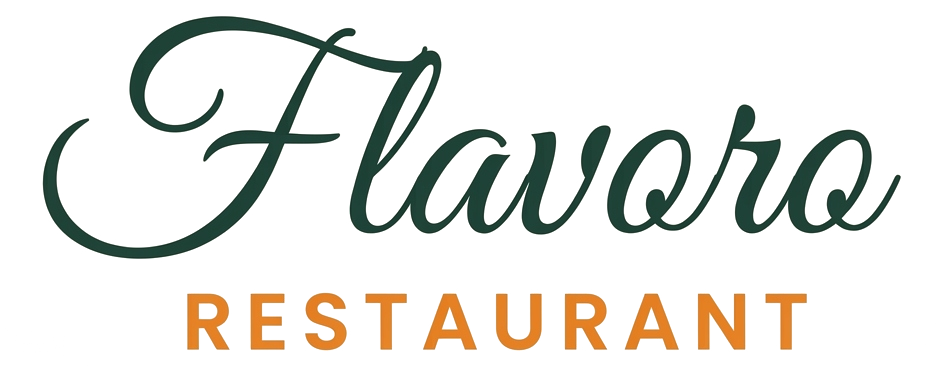
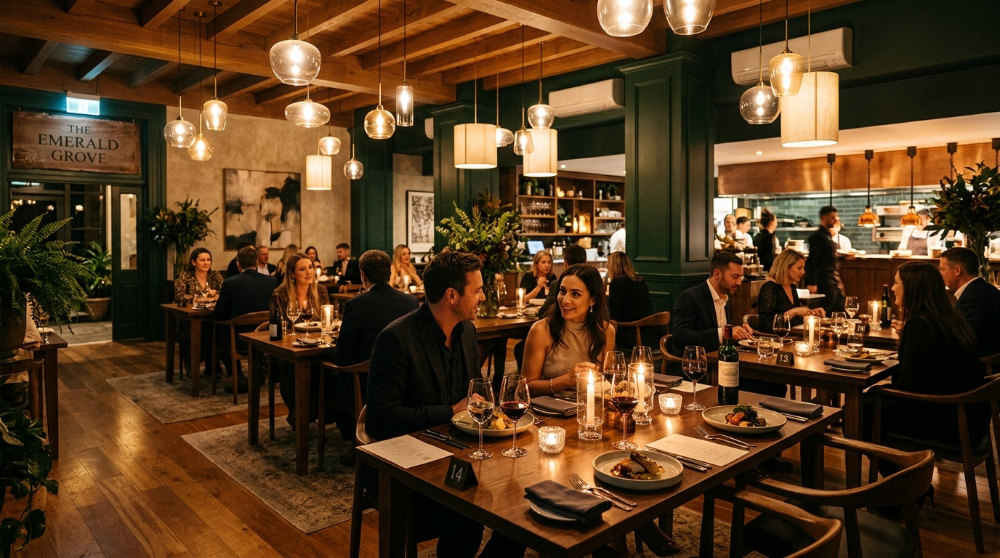
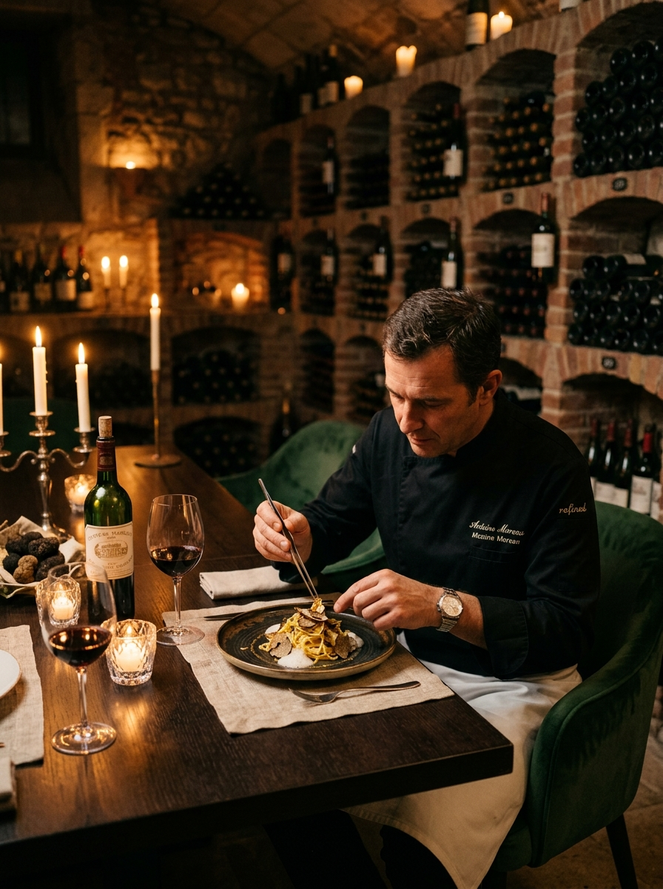
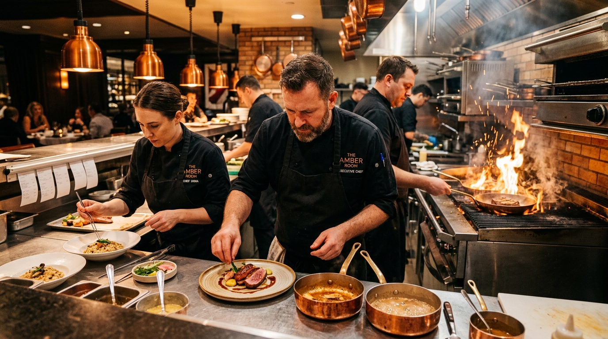
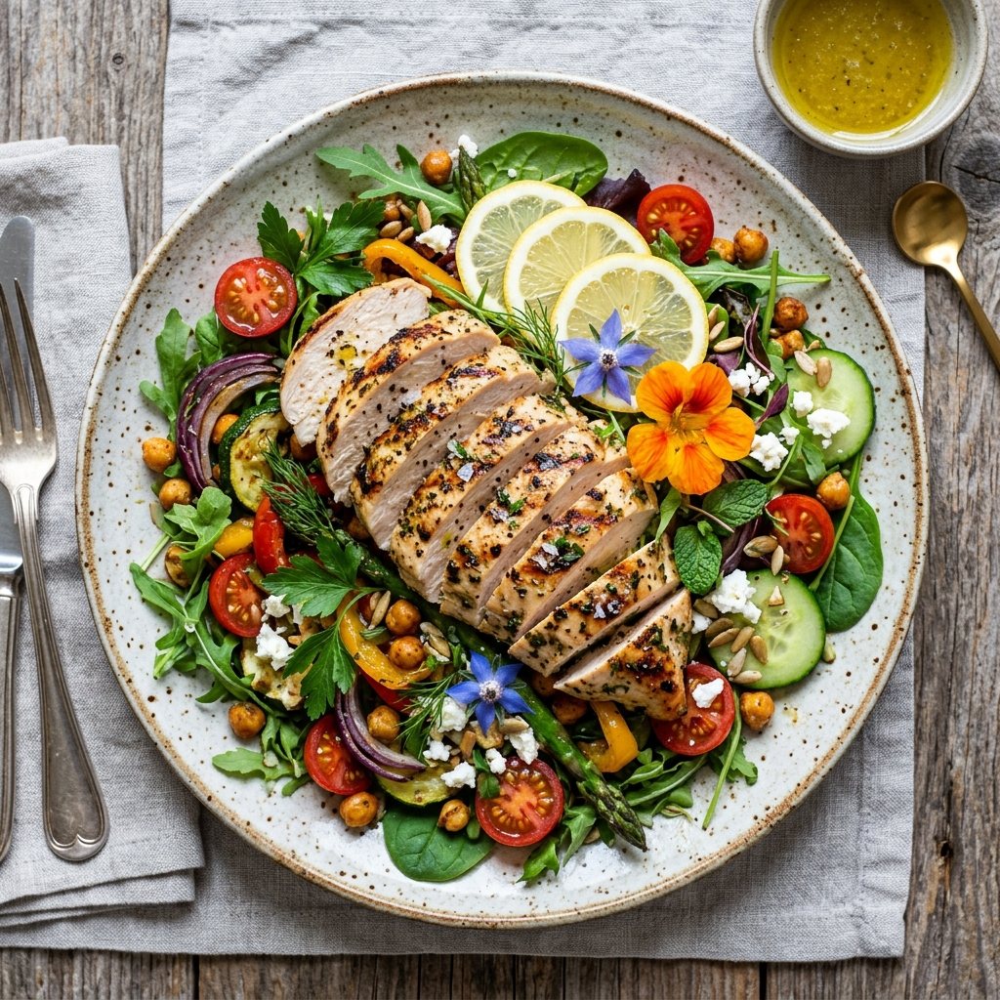

<div align="center">

  

  # Flavoro — Haute Gastronomy & Artisanal Bar
  ### *A Michelin-Caliber Fine Dining Experience & Executive Restaurant Management Suite*

  [](https://parhamje.github.io/flavoro/)
  [](https://react.dev/)
  [](https://vitejs.dev/)
  [](https://tailwindcss.com/)
  [](https://github.com/parhamje/flavoro/actions)
  [](https://opensource.org/licenses/MIT)

  <p align="center">
    <a href="https://parhamje.github.io/flavoro/"><b>Explore Live Demo »</b></a>
    ·
    <a href="#-key-features"><b>View Features</b></a>
    ·
    <a href="#-admin-executive-console"><b>Admin Console</b></a>
    ·
    <a href="#-getting-started"><b>Run Locally</b></a>
  </p>

</div>

---

## 🌟 Executive Summary

**Flavoro** is a luxury, responsive web platform engineered for fine-dining establishments, private dining clubs, and boutique hospitality brands. Built with **React 18**, **Vite**, and **Tailwind CSS**, Flavoro bridges high-touch culinary storytelling with high-precision operational tools.

It delivers a seamless end-to-end journey: from an immersive **liquid-gold preloader** and **tasting menu curator** to a **VIP Guest Connoisseur Portal** and a **live-sync Kitchen Expedite & Table Turnaround Console**.

---

## 📸 Visual Showcase

| Haute Gastronomy Experience | Sommelier & Vault Dining |
| :---: | :---: |
|  |  |

| Michelin Kitchen Expedite | Artisanal Culinary Creations |
| :---: | :---: |
|  |  |

---

## ✨ Key Features

### 🍽️ 1. Haute Gastronomy Guest Experience
- **Liquid Gold Preloader**: Bespoke brand preloader featuring a cloche reveal and a dynamic progress bar embedded inside the restaurant name.
- **Curated Tasting Menu**: Filter by *Chef Signatures*, *Starters*, *Mains*, *Artisanal Pizzas*, *Valrhona Desserts*, and *Sommelier Cocktails*. Includes spice/dietary indicators, sommelier pairings, and calorie breakdown.
- **Interactive Reservation Vault**: Date, party size, and seating area picker (Main Hall, Private Vault, Garden Terrace) with instant booking confirmation, calendar sync, and celebratory confetti.
- **Artisanal Dining Gallery**: Responsive multi-category visual showcase with high-res lightbox modals.
- **Cart & Order Drawer**: Real-time course tracking, itemized pricing, sommelier service calculation, and toast notifications.

---

### 👑 2. Customer VIP Dining Portal (`/user-dashboard`)
Inspired by private member clubs and Michelin 3-Star hospitality:
- **Metallic Connoisseur Card**: High-contrast emerald & gold membership card with live loyalty points tally (`450 / 600 PTS`) and liquid-gold progress bar toward *Diamond Connoisseur* tier.
- **Tonight's Live Service Journey**: Real-time 4-stage tracking timeline:
  1. *Booking Confirmed*
  2. *White Linen Dressed & Crystal Set*
  3. *Cellar Pairings Chilled*
  4. *Host Stand Reception Pass*
- **Interactive Taste & Sensory Matrix**: Guests customize complimentary table water (*Lurisia Sparkling, Acqua Panna, Citrus Mineral*), atmosphere preference, strict dietary restrictions (*Shellfish, Gluten-Free, Vegan*), tableside truffle shaving toggles, and private sommelier notes.
- **Itemized Receipts & Invoices**: Detailed course breakdown, gratuity, sommelier fees, and simulated PDF invoice generation.
- **Expedited QR Check-In**: Instant digital host stand pass for contactless seating.

---

### 🍳 3. Admin Executive Command Console (`/admin-dashboard`)
An operations suite engineered for Executive Chefs and General Managers:
- **Live Service Clock**: Real-time digital clock (`LIVE DINNER SERVICE • 21:29:12`) with active service heartbeat.
- **4 Station Brigade Heartbeats**:
  - *Hearth & Wood Grill* (Chef Marcus Vance — 8 Tickets • 14m Avg)
  - *Handmade Pasta & Truffle* (Sous Chef Lorenzo — 12 Tickets • High Rush)
  - *Sommelier Vault Pass* (Lucas Vance — 15 Tickets • 4m Avg)
  - *Valrhona Pastry & Gelato* (Amelie Laurent — 6 Tickets • Steady)
- **Live KDS Expedite Stream**: Real-time ticket management with course fire alerts, dietary flags, and ticket status progression (*Prep -> Plating -> Passed*).
- **Interactive Floor Plan Matrix**: Live table management grid showing real-time occupancy (*Available, Seated, VIP Reserved, Bill Settling*) with 1-click status updates.
- **Executive Financial KPIs**: Real-time metrics for Gross Daily Revenue, Dinner Floor Occupancy, Average Spend per Cover (PPA), and Food Cost Ratio benchmark.

---

### 📱 4. Mobile & Micro-Interaction Suite
- **Pixel-Perfect Navigation**: Symmetrical 300ms rotational morphing between Lucide `<Menu />` and `<X />` icons.
- **Spring-Pop Profile Dropdown**: Fluid pop animation (`animate-dropdown-pop`) with active border accents and 180° rotating chevron.
- **Mutual Exclusion**: Seamless state management ensuring drawers and popups never clash or overlap on mobile viewports.
- **Fluid Micro-Animations**: Tailored page transitions, shimmering gold badges, and subtle parallax scroll reveals.

---

## 🛠️ Technology Stack

| Layer | Technologies |
| :--- | :--- |
| **Frontend Framework** | [React 18.3](https://react.dev/) (Hooks, Context API, Suspense) |
| **Build Tool & Bundler** | [Vite 6.0](https://vitejs.dev/) (Lightning-fast HMR & optimized production chunking) |
| **Styling & Design System** | [Tailwind CSS 3.4](https://tailwindcss.com/) + Custom Gastronomy Design Tokens |
| **Iconography** | [Lucide React](https://lucide.dev/) (Modern, consistent, lightweight SVG icons) |
| **FX & Celebrations** | [Canvas-Confetti](https://www.npmjs.com/package/canvas-confetti) |
| **Typography** | Google Fonts: *Playfair Display*, *DM Serif*, *Plus Jakarta Sans*, *Alex Brush* |
| **CI / CD & Hosting** | [GitHub Pages](https://pages.github.com/) via [GitHub Actions](https://github.com/features/actions) |
| **Multi-Host Ready** | [Vercel](https://vercel.com/) & [Netlify](https://www.netlify.com/) (pre-configured with `vercel.json` & `_redirects`) |

---

## 📁 Project Architecture

```plaintext
flavoro/
├── .github/
│   └── workflows/
│       └── deploy.yml          # Automated CI/CD GitHub Actions pipeline
├── public/
│   ├── _redirects              # Netlify & Cloudflare SPA rewrite rules
│   └── assets/                 # High-resolution culinary imagery & icons
├── src/
│   ├── components/             # Reusable UI elements
│   │   ├── BookingModal.jsx    # Table reservation modal with confetti
│   │   ├── CartDrawer.jsx      # Slide-out dining bag & checkout
│   │   ├── LightboxModal.jsx   # Fullscreen gallery image preview
│   │   ├── LoadingScreen.jsx   # Liquid gold cloche preloader
│   │   ├── Logo.jsx            # Adaptive dual-mode brand logo
│   │   ├── Navbar.jsx          # Responsive header with mobile drawer
│   │   ├── Footer.jsx          # Luxury footer with newsletter & hours
│   │   └── ToastContainer.jsx  # Notification stream
│   ├── context/
│   │   └── AppContext.jsx      # Global state (auth, cart, booking, preferences)
│   ├── data/
│   │   └── restaurantData.js   # Tasting menu, gallery items, chef profiles
│   ├── hooks/
│   │   └── useScrollReveal.js  # Intersection observer scroll animations
│   ├── pages/
│   │   ├── HomePage.jsx        # Landing page with hero, philosophy & cellar
│   │   ├── MenuPage.jsx        # Interactive categorized dining menu
│   │   ├── AboutPage.jsx       # Heritage, culinary vision & brigade
│   │   ├── GalleryPage.jsx     # Haute gastronomy media archive
│   │   ├── ContactPage.jsx     # Location, private dining inquiries & map
│   │   ├── LoginPage.jsx       # VIP Connoisseur authentication
│   │   ├── SignUpPage.jsx      # Guest registration
│   │   ├── UserDashboard.jsx   # VIP Member Portal & taste matrix
│   │   └── admin/              # Executive Operations Suite
│   │       ├── AdminLayout.jsx # Command bar with live service clock
│   │       ├── AdminDashboard.jsx # Expedite stream & brigade stations
│   │       ├── AdminMenu.jsx   # Live dish & pricing management
│   │       ├── AdminReservations.jsx # Floor plan matrix & guest book
│   │       └── AdminStaff.jsx  # Brigade shift & station roster
│   ├── App.jsx                 # Master application routing & layout
│   ├── main.jsx                # React root mount
│   └── index.css               # Custom keyframes, typography & scrollbars
├── vercel.json                 # Vercel SPA rewrite fallback
├── vite.config.js              # Vite bundler configuration with relative base
└── package.json                # Project dependencies & scripts
```

---

## 🚀 Getting Started

Follow these instructions to run Flavoro locally on your machine:

### Prerequisites
- [Node.js](https://nodejs.org/) (version **18.0** or higher)
- [npm](https://www.npmjs.com/) or [yarn](https://yarnpkg.com/)
- [Git](https://git-scm.com/)

### 1. Clone the Repository
```bash
git clone https://github.com/parhamje/flavoro.git
cd flavoro
```

### 2. Install Dependencies
```bash
npm install
```

### 3. Launch Development Server
```bash
npm run dev
```
Open **`http://localhost:3000`** in your browser to experience the site live.

### 4. Build for Production
```bash
npm run build
```
Outputs a production-ready, minified static build to the `dist/` directory.

### 5. Preview Production Bundle Locally
```bash
npm run preview
```

---

## 🌐 Deployment

### GitHub Pages (Automated CI/CD)
The project is configured with a automated GitHub Actions workflow located in `.github/workflows/deploy.yml`. Every commit pushed to `main` will trigger a clean build and update the live site at:
**[https://parhamje.github.io/flavoro/](https://parhamje.github.io/flavoro/)**

### 1-Click Manual Deploy
You can also deploy manually at any time using `gh-pages`:
```bash
npm run deploy
```

### Deploying to Vercel or Netlify
- **Vercel**: Import the GitHub repository at [vercel.com](https://vercel.com). The pre-configured `vercel.json` ensures full SPA rewrite support.
- **Netlify**: Connect your repo or drag-and-drop the `dist/` folder at [app.netlify.com/drop](https://app.netlify.com/drop). The `public/_redirects` file automatically handles routing.

---

## 📄 License

This project is licensed under the **MIT License** — feel free to use, modify, and distribute for personal or commercial projects.

---

<div align="center">
  <sub>Crafted with passion for haute gastronomy and modern web engineering.</sub>
  <br/>
  <b><a href="https://parhamje.github.io/flavoro/">Experience Flavoro Live »</a></b>
</div>
